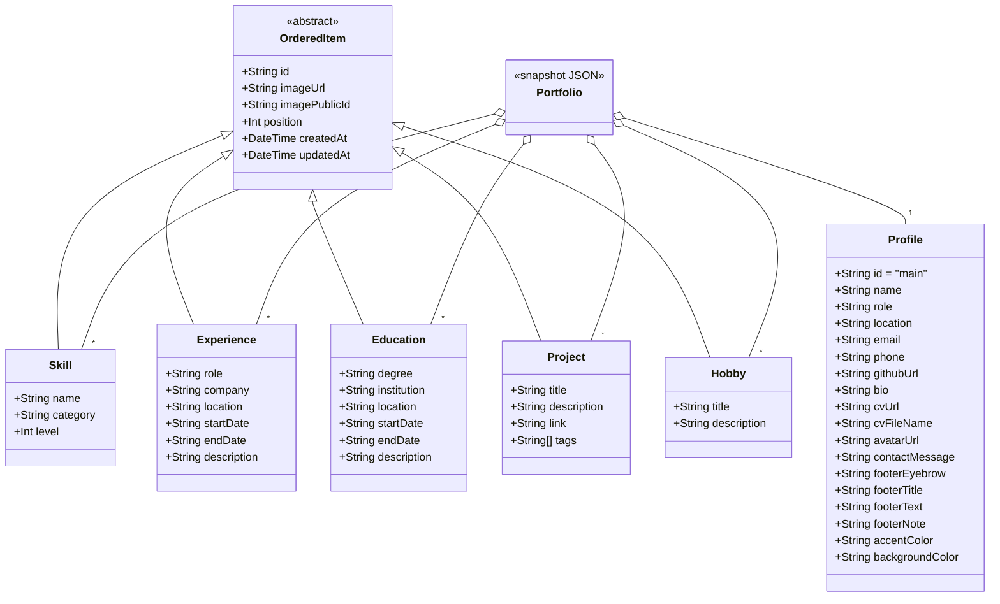
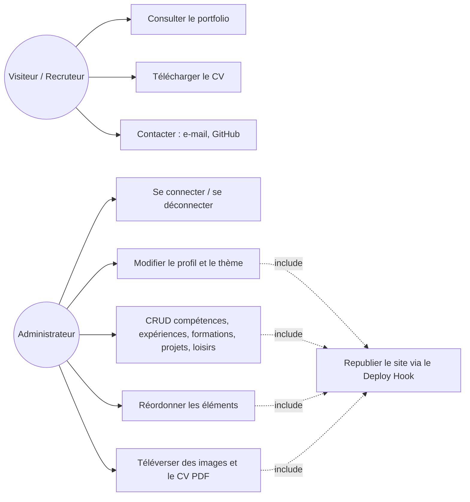
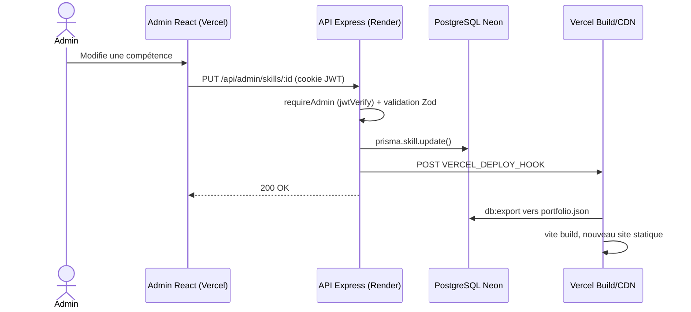
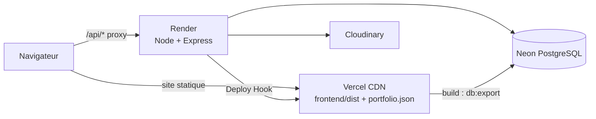

# Portfolio full-stack

Le front React et le back Node sont deux applications distinctes :

- `frontend/` : React + Vite, site public statique et interface `/admin`.
- `backend/index.js` : API REST Express/Node, authentification et CRUD.
- `backend/prisma/` : schéma, migrations et génération Prisma.

Depuis l’admin, tu peux gérer tes compétences (avec logos), expériences professionnelles, formations, projets et loisirs illustrés, importer ton CV au format PDF, ainsi que modifier tes coordonnées (e-mail, téléphone et profil GitHub), le message du lien e-mail et les textes/couleurs du pied de page. Le CV est proposé au téléchargement sur le portfolio public.

Le portfolio public est construit à partir d’un snapshot JSON et servi par le CDN Vercel. Il ne contacte ni le serveur Node ni la base quand un recruteur le visite. Après chaque modification admin, l’API sauvegarde dans PostgreSQL et déclenche automatiquement une nouvelle publication Vercel. L’ancienne vitrine reste disponible pendant la publication. Le service API Render gratuit peut s’endormir : seule l’ouverture de l’admin ou une modification après une période inactive peut être plus lente.

## Stack et hébergement

- **React + Vite** : front-end, déployé statiquement sur Vercel.
- **Node.js + Express** : API dans `backend/index.js`, déployée sur Render.
- **Prisma 7 + PostgreSQL Neon** : ORM, migrations et données.
- **Cloudinary** : téléversement et diffusion des photos.
- **GitHub + Vercel Deploy Hook** : publication automatique du nouveau snapshot après une modification.

Les services gratuits ont des limites et peuvent évoluer ; ils ne garantissent pas une disponibilité absolue.

## Démarrage local sans configuration

1. Installe Node.js 20.19 ou plus récent.
2. À la racine du projet, installe les dépendances et démarre les deux serveurs avec une seule commande :

   ```powershell
   npm install
   npm run dev
   ```

Au premier démarrage, l’application crée automatiquement un compte admin et une clé de session dans `.env` si nécessaire. Les identifiants sont affichés une seule fois dans le terminal. Les données sont enregistrées dans `backend/data/portfolio.json` et les médias locaux (photos et CV PDF jusqu’à 10 Mo) dans `backend/uploads/`; ces deux dossiers restent sur ta machine et sont ignorés par Git. Aucune base Neon, aucun compte Cloudinary et aucun secret manuel ne sont nécessaires pour travailler localement.

- Site public : `http://localhost:5173`
- Administration : `http://localhost:5173/admin`
- Vérification de l’API : `http://localhost:4000/api/health` (stockage `local-file`)

Les changements enregistrés par l’admin apparaissent directement sur le site local. L’API ne redémarre pas à chaque écriture de fichier, afin de ne pas couper les téléversements ou l’enregistrement des données ; après une modification du code backend, redémarre `npm run dev`. Pour arrêter les deux serveurs, appuie sur `Ctrl+C` dans le terminal.

## Déploiement hébergé

Le mode local ne dépend pas d’un fournisseur externe. En revanche, publier le site sur Vercel/Render nécessite de créer et autoriser tes comptes d’hébergement et de base de données : ces accès ne peuvent pas être générés automatiquement par le code. Pour le déploiement avec PostgreSQL Neon, Cloudinary et publication Vercel, suis les étapes ci-dessous et ajoute les variables secrètes directement dans les paramètres des fournisseurs, jamais au dépôt.

## Déploiement automatique

1. Crée une base Neon et un compte Cloudinary, puis pousse le projet sur GitHub.
2. Crée un service Render depuis le dépôt ; le fichier `render.yaml` configure le service API. Ajoute-y les valeurs de `.env` et `FRONTEND_URL` (URL Vercel finale). Render applique les migrations et insère le contenu initial au build.
3. Crée le projet Vercel depuis le même dépôt. Le fichier `vercel.json` construit `frontend/`, sert le dossier statique et relaie `/api/*` vers `https://folio-api.onrender.com`.
4. Dans Vercel, configure `DATABASE_URL` et `DIRECT_URL` pour que le build puisse créer le snapshot public. Crée ensuite un **Deploy Hook** dans les paramètres Git du projet et ajoute son URL comme `VERCEL_DEPLOY_HOOK` dans Render.
5. Ajoute à Render `FRONTEND_URL=https://<ton-projet>.vercel.app` et redéploie le service API.

Le hook de déploiement et les identifiants restent des secrets serveur. Ne les préfixe pas avec `VITE_` et ne les ajoute jamais au dépôt. Pour un domaine personnalisé, ajoute son origine à `FRONTEND_URL` sur Render.

## Résumé technique et conception

### Stack détaillée

| Couche | Technologie |
|---|---|
| Front-end | React 19 + Vite 6, icônes `lucide-react` (`frontend/src/App.jsx`, `frontend/src/admin.jsx`) |
| Back-end | Node.js ≥ 20.19 + Express 5 (`backend/index.js`) |
| ORM / BDD | Prisma 7 + PostgreSQL Neon (`@prisma/adapter-neon`) |
| Validation | Zod 4 |
| Authentification | bcryptjs (hash du mot de passe) + jose (JWT HS256 en cookie httpOnly `folio_admin`, 7 jours) + `express-rate-limit` sur la connexion (10 essais / 15 min) |
| Médias | Cloudinary (upload signé) en production, `backend/uploads/` en local |
| Hébergement | Vercel (front statique, proxy `/api/*` vers Render) + Render (API) |
| Mode local | `backend/local-store.js` remplace Prisma (stockage dans `backend/data/portfolio.json`) |
| Monorepo | npm workspaces (`frontend`, `backend`), `npm run dev` lance les deux serveurs (`scripts/dev.js`) |

### Modèle de données (Prisma)

Le schéma (`backend/prisma/schema.prisma`) contient six entités indépendantes, sans relation entre elles :

- **Profile** : un seul enregistrement (id `"main"`) avec nom, métier, ville, e-mail, téléphone, GitHub, bio, CV, avatar, message de contact, textes du pied de page, couleur d'accent et couleur de fond.
- **Skill** : nom, catégorie, niveau (1 à 5), logo.
- **Experience** : poste, entreprise, lieu, dates, description, image.
- **Education** : diplôme, établissement, lieu, dates, description, image.
- **Project** : titre, description, image, lien, `tags[]`.
- **Hobby** : titre, description, image.

Champs communs : `id` (cuid), `imageUrl` / `imagePublicId` (Cloudinary), `position` (indexé, ordre d'affichage), `createdAt` / `updatedAt`.

### Diagramme de classes



`OrderedItem` et `Portfolio` sont des abstractions conceptuelles et ne sont pas des tables. `Portfolio` correspond à la réponse de `GET /api/portfolio` et au snapshot JSON.

### Diagramme de cas d'utilisation



### Diagramme de séquence : une modification admin



### Diagramme de déploiement



### API REST

- **Public** : `GET /health`, `GET /api/health`, `GET /api/portfolio`
- **Authentification** : `POST /api/admin/login`, `GET /api/admin/me`, `POST /api/admin/logout`
- **CRUD** (protégé par `requireAdmin`) : `PUT /api/admin/profile`, puis `POST`, `PUT /:id` et `DELETE /:id` sur `skills`, `projects`, `experiences`, `education` et `hobbies`
- **Ordre d'affichage** : `POST /api/admin/:collection/:id/move`
- **Uploads** : `POST /api/admin/upload-local` et `POST /api/admin/upload-cv-local` (mode local), `POST /api/admin/upload-signature` (signature Cloudinary en production)
